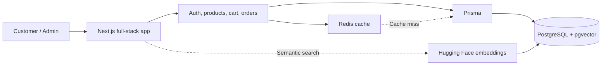

<div align="center">

# StoreIQ — The Smart E-commerce Store

### Browse products. Search by meaning. Check out with confidence.

<p>
  
  
</p>
<p>
  
  
</p>
<p>
  
  
  
</p>

<p><strong>StoreIQ makes product discovery, secure checkout, and order management smarter and simpler.</strong></p>
<p>Semantic search runs locally with Hugging Face embeddings and PostgreSQL pgvector.</p>

</div>

## Requirements

- Node.js 20.9 or newer
- npm
- Docker Desktop for local PostgreSQL/pgvector and Redis services

## Setup

```powershell
npm install
Copy-Item .env.example .env

# Start PostgreSQL with pgvector and the local Redis cache.
docker compose up -d

# Apply database migrations and load demo accounts/products.
npm run db:migrate
npm run db:seed

npm run dev
```

Open [http://localhost:3000](http://localhost:3000).

The checked-in `.env.example` contains local-only values. For deployment,
provide a strong unique `AUTH_SECRET`, a production `DATABASE_URL`, and a
Redis `REDIS_URL` using your hosting provider's secret manager; never commit
them.

The first seed/index or semantic-search run downloads the local embedding
model from Hugging Face and caches it locally. Product/query text is
embedded in the Node.js server and is not sent to a hosted embedding API.
To rebuild product vectors later, run `npm run db:index-embeddings`.

## Redis cache

The local `docker compose up -d` command starts Redis Stack alongside
PostgreSQL. Its RedisInsight GUI is available at
[http://localhost:8001](http://localhost:8001); Redis itself remains available
to the app at `redis://localhost:6379`.
Set `REDIS_URL="redis://localhost:6379"` in `.env` (add it manually if `.env`
already existed before Redis was added). Cache entries expire after these
time-to-live (TTL) durations:

| Cached data | TTL |
| --- | --- |
| Product catalogue and filtered catalogue queries | 5 minutes |
| Individual product details | 5 minutes |
| Product categories | 30 minutes |
| Semantic-search results | 2 minutes |

Product changes made through the app invalidate the catalogue and
semantic-search caches. Changes made directly through Prisma Studio or SQL
become visible when their cache entries expire.

Redis is only a disposable cache; PostgreSQL remains the source of truth. If
Redis is unavailable, the app logs a warning and reads from PostgreSQL without
caching. Both Redis and RedisInsight ports are bound to this computer. Use the
GUI only with the local development database; the cache is not persistent
across container recreation.

## Prisma Studio

Start the local database and configure `DATABASE_URL` in `.env`, then run:

```powershell
npm run db:studio
```

Open [http://localhost:51212/](http://localhost:51212/) to access the running
Prisma Studio instance. The port may differ when Studio is restarted; use the
URL printed in the terminal in that case.

Prisma Studio opens a local browser interface for viewing and editing database
records. It connects to the database specified by `DATABASE_URL`; changes made
in Studio directly affect that database. Use a development database, and avoid
exposing Studio or using it to edit production data.

## Demo accounts

After running the seed command, use these local-only demo accounts:

- Customer: `alice@example.com` / `password123`
- Admin: `bob@example.com` / `password123`

Registration always creates a `CUSTOMER`; admin accounts are provisioned by
the seed script. Replace the example `AUTH_SECRET` before deploying.

## Store workflows

- Use the shared navigation to reach the catalogue and, when signed in,
  customer orders/cart or admin tools.
- Browse and filter active products at `/products`.
- Search the catalogue by describing a product's purpose or features;
  embeddings run locally and use PostgreSQL/pgvector for similarity.
- Add products to your cart and place an order. Checkout computes totals from
  current database prices in Indian rupees (INR); payment remains simulated.
- View your own orders at `/orders`.
- Admins can add/edit/deactivate products, update stock, and manage order
  statuses at `/admin`.

## Checks

```powershell
npm run lint
npm run typecheck
npm run test:auth
npm run test:workflows
npm run build
```

For the browser workflow, database/view checks, and safe SQL examples, follow
[`docs/testing.md`](./docs/testing.md). To stop the local database, run
`docker compose down`; add `-v` only if you intend to delete its stored data.

The project demonstrates serializable checkout transactions, relational and
vector indexes, an `AdminSalesSummary` PostgreSQL view, and pgvector cosine
search. Safe SQL examples for the database assignment are in
[`docs/important-queries.sql`](./docs/important-queries.sql); database
verification steps are in [`docs/testing.md`](./docs/testing.md).

## Architecture



Next.js serves the UI and API. Prisma connects the app services to PostgreSQL;
local Hugging Face embeddings power product semantic search, and Redis speeds
up repeated catalogue and semantic-search reads.

## Project structure

```text
.
├── docs/                 # Requirements, database design, SQL examples, tests
├── prisma/
│   ├── schema.prisma     # Relational schema and models
│   └── migrations/       # PostgreSQL and pgvector migrations
├── public/               # Static assets
├── scripts/              # Seed data and product embedding indexing
├── src/
│   ├── app/              # Next.js pages, layouts, and API route handlers
│   ├── components/       # Reusable UI for auth, products, cart, and admin
│   ├── lib/              # Database, Redis cache, auth, workflow, and search
│   └── types/            # Shared TypeScript declarations
├── docker-compose.yml    # Local PostgreSQL + pgvector service
├── prisma.config.ts      # Prisma CLI configuration
└── package.json          # Scripts and project dependencies
```

Project scope and implementation status are tracked in
[`IMPLEMENTATION.md`](./IMPLEMENTATION.md).
The schema overview and requirements are in
[`docs/er-diagram.mmd`](./docs/er-diagram.mmd) and
[`docs/requirements.md`](./docs/requirements.md).
