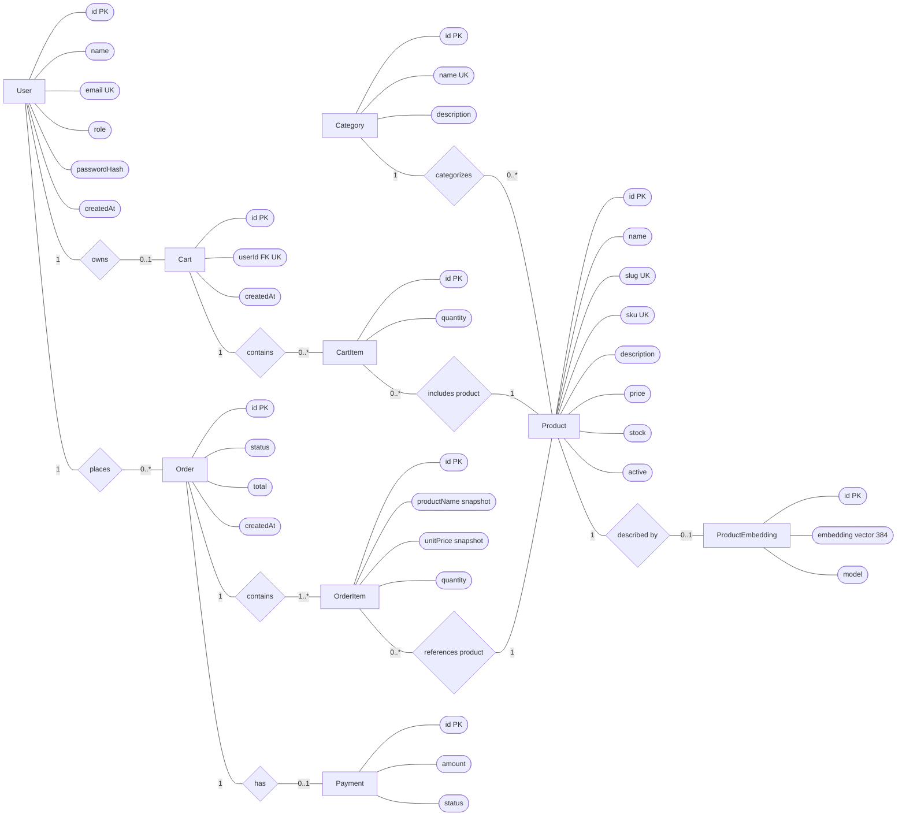

# StoreIQ Chen-Style ER Diagram

This Chen-style ER diagram uses rectangles for entities, ovals for attributes,
and diamonds for relationships. `CartItem` and `OrderItem` are associative
entities: they resolve many-to-many relationships and store attributes of
those relationships.

## Relationship summary

- A user may have zero or one cart and may place many orders. Each cart belongs
  to exactly one user.
- A cart contains cart items; each cart item refers to one product. The unique
  cart-product pair prevents duplicate product rows in a cart.
- A category can contain many products; each product belongs to one category.
- An order contains one or more order items. Each order item refers to one
  product and keeps its name and unit-price snapshots to preserve order history.
- An order may have one payment, and a product may have one search embedding.

`PK` means primary key, `FK` means foreign key, and `UK` means a unique key.
The unique `Cart.userId` constraint enforces the one-cart-per-user
relationship in the relational schema.

The relational schema is defined in
[`../prisma/schema.prisma`](../prisma/schema.prisma), and the database mapping
is described in [`database-design.md`](./database-design.md).
