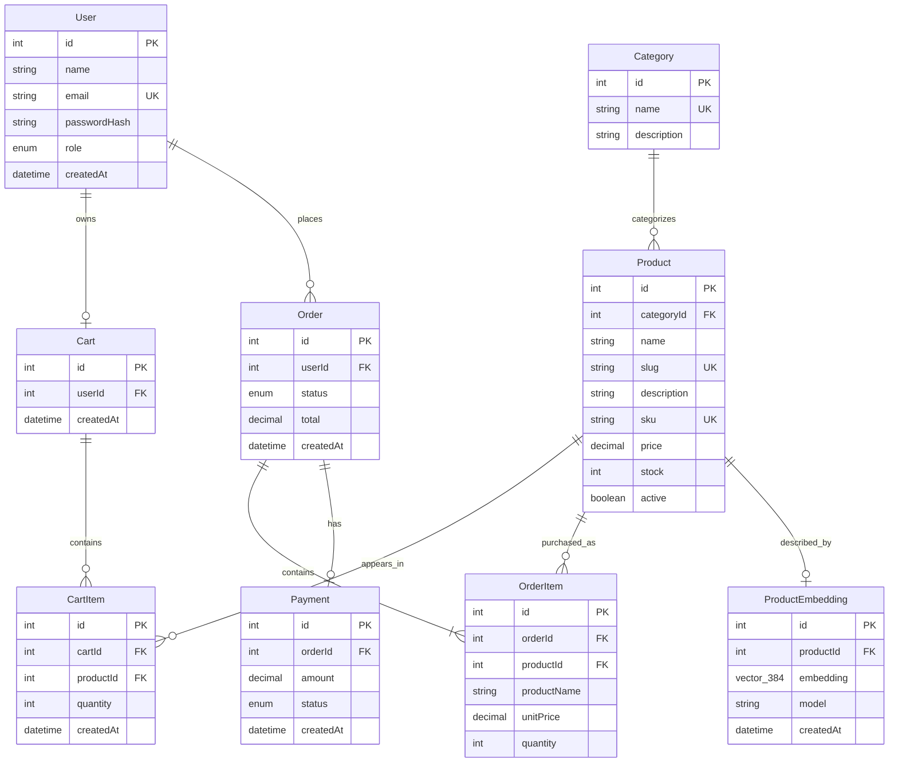

# StoreIQ Entity-Relationship Model

This ER diagram shows the core e-commerce entities and how they relate.
`CartItem` and `OrderItem` represent relationships that contain their own
attributes, such as product quantity and purchase-time price.

## Relationship summary

- A user may have one cart and may place many orders.
- A cart contains cart items; each cart item refers to one product.
- A category can contain many products; each product belongs to one category.
- An order contains one or more order items. Order items keep a snapshot of
  product name and unit price so order history is preserved.
- An order may have one payment, and a product may have one search embedding.

`PK` means primary key, `FK` means foreign key, and `UK` means a unique key.
The unique `Cart.userId` constraint enforces the one-cart-per-user
relationship, even though the Mermaid ER notation only labels it as an `FK`.

The relational schema is defined in
[`../prisma/schema.prisma`](../prisma/schema.prisma), and the database mapping
is described in [`database-design.md`](./database-design.md).
